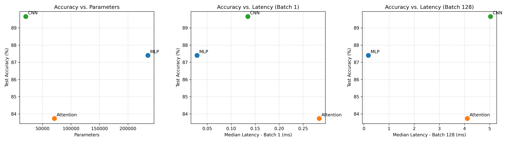

# Lab 3: Architectures and their Costs

## 1. Model Summary & Cost Comparison

| Architecture | Parameters (`torchinfo`) | `thop` FLOPs (2×MACs) | Median Latency B=1 (ms) | Median Latency B=128 (ms) | Test Accuracy (%) |
| :--- | :---: | :---: | :---: | :---: | :---: |
| **MLP** | 235,146 | 469,504 | 0.029 | 0.178 | 87.40% |
| **CNN** | 20,490 | 2,063,488 | 0.135 | 5.033 | 89.66% |
| **Attention** | 70,794 | 1,182,976 | 0.284 | 4.110 | 83.73% |

## 2. Hand-Calculated vs. Measured FLOPs

- **MLP (`Linear(784, 256)`):**
  $$2 \times 784 \times 256 = 401,408 \text{ FLOPs}$$
- **CNN (`Conv2d(1, 16, 3, padding=1)`):**
  $$2 \times 3 \times 3 \times 1 \times 16 \times 28 \times 28 = 225,792 \text{ FLOPs}$$
- **Attention (`seq=16, d_model=64`):**
  - QKV Projections: $2 \times 16 \times 64 \times (3 \times 64) = 393,216 \text{ FLOPs}$
  - Attention Scores ($QK^T$): $2 \times 16^2 \times 64 = 32,768 \text{ FLOPs}$

**Explanation of Gap Between Hand-Calculated and `thop` FLOPs:**
1. **MACs vs. FLOPs convention:** `thop` reports MACs (Multiply-Accumulate operations), whereas textbook formulas count 1 MAC as 2 FLOPs (1 multiply + 1 add).
2. **Omitted non-linear and normalization ops:** Hand calculations focus on dominant GEMM/convolution operations and omit elementwise ops (ReLU, GELU, Softmax, LayerNorm, MaxPool, residual additions, and bias additions), whereas `thop` either ignores custom/fused modules (such as `nn.MultiheadAttention` internal projections depending on version) or counts elementwise operations differently.

## 3. Trade-Off Plots

## 4. Architectural Trade-Offs & Access Patterns (§4.6–4.7)

- **Most Cost-Effective Architecture:** **CNN** achieves the highest test accuracy with the lowest parameter count among the three models.
- **Spatial Locality & Weight Sharing (CNN):** Convolutions reuse small $3 \times 3$ filter weights across the $28 \times 28$ grid, maximizing L1/L2 cache hit rates and arithmetic intensity. However, sliding-window memory access across feature maps introduces intermediate activation memory traffic that increases latency relative to a simple MLP.
- **Memory-Bound Execution (MLP):** Flattening removes spatial inductive bias, requiring large weight matrices (`784×256`) to learn pixel correlations from scratch. For Batch = 1, matrix-vector multiplication is memory-bandwidth bound (loading weights once per sample), yielding very fast execution on small inputs due to contiguous memory reads.
- **Data Movement & Quadratic Scaling (Attention):** Splitting the image into 16 patches reduces spatial resolution early, and self-attention incurs frequent tensor reshaping, LayerNorm passes, and quadratic $O(\text{seq}^2)$ attention score lookups. At small sequence lengths ($\text{seq}=16$) and small batch sizes, kernel launch and memory-movement overhead dominate compute time, making Attention less efficient than CNNs for low-resolution vision tasks.
